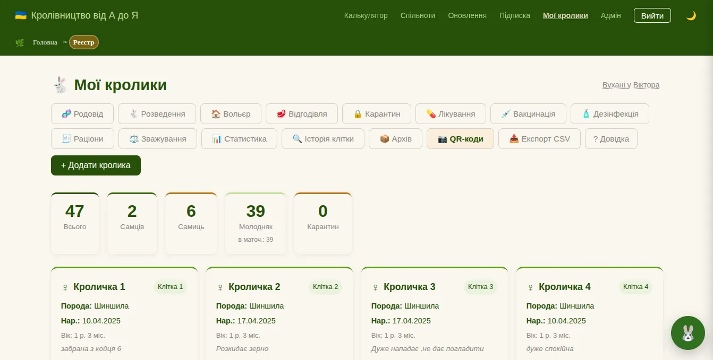
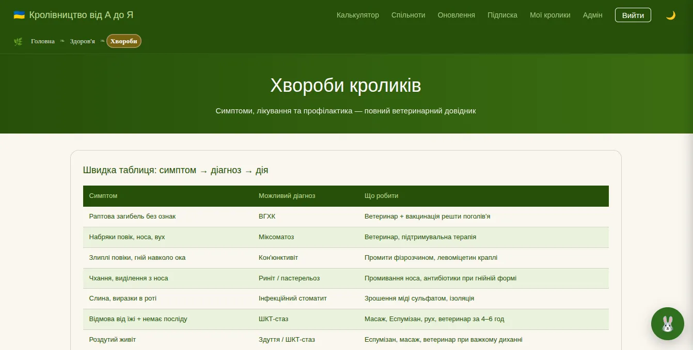
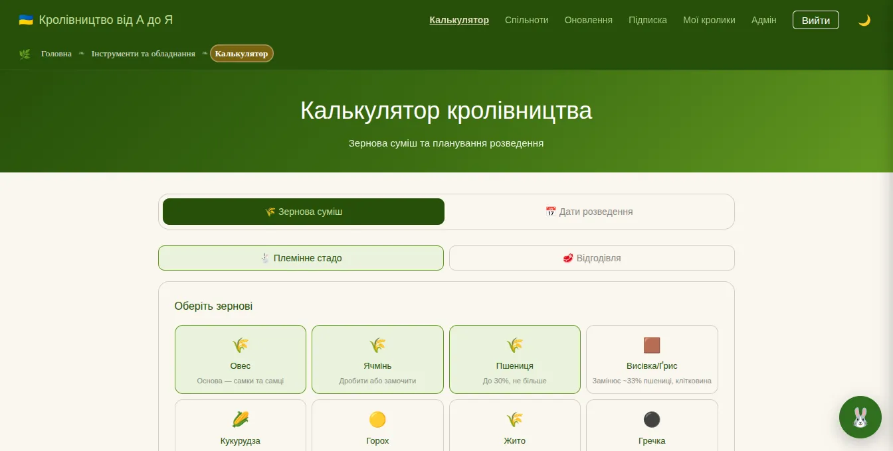
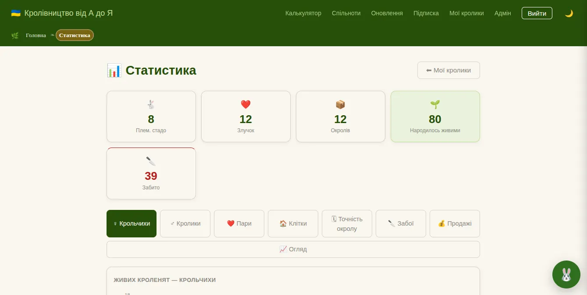
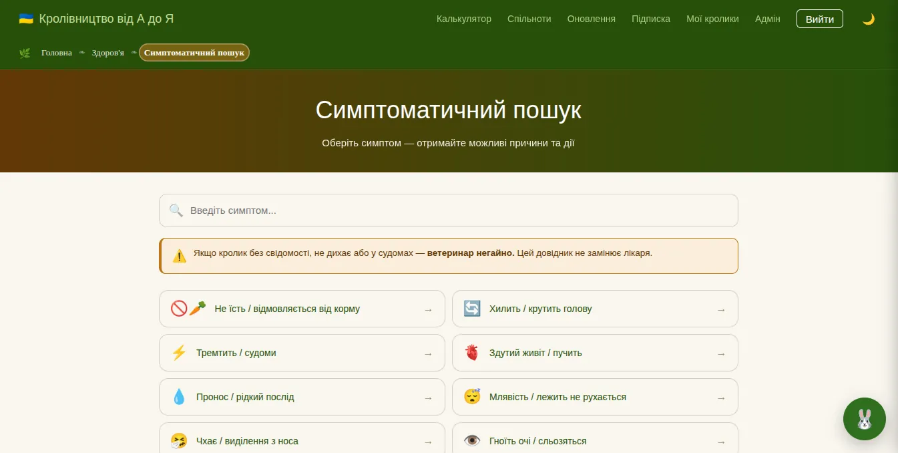

# Кролівництво від А до Я

<p align="center">
  
</p>

<p align="center">
  <a href="https://github.com/ViktorPro1/Rabbit-farming-from-A-to-Z-React-/actions/workflows/ci.yml"></a>
  
  
</p>

Сучасний **PWA-застосунок** для кролівників: великий тематичний довідник, система обліку господарства та практичні інструменти для щоденної роботи.

Проєкт розроблений на **React 19 + TypeScript + Vite + Supabase** з акцентом на продуктивність, SEO, офлайн-режим і модульну архітектуру.

**Відкрити застосунок:** https://rabbit-farming-from-a-to-z-react.vercel.app/

---

## Можливості

**Довідник**

- 202 публічні сторінки у 26 тематичних розділах
- Симптоматичний пошук і довідник хвороб
- Практичні рекомендації та калькулятори
- Блоки «Просування господарства та репутація» (7 сторінок) і «Крафтове виробництво» (4 сторінки)

**Облік господарства**

- Реєстр кролів, злучки, окроли, статистика
- Автогенерація номерів кролів (модуль «Нумерація»), «План підбору самок»
- Облік залишків кормів і партій
- [Фінансовий облік](docs/Можливості/FINANCES.md): доходи, витрати, прибуток по місяцях
- [Календар господарства](docs/Можливості/FARM_CALENDAR.md): інтерактивна сітка місяця
- QR-паспорти кролів, публічні профілі кролів і партій відгодівлі, сторінка-візитка господарства (`/vizytka`)

**Спільнота та сповіщення**

- Закритий чат учасників: реакції, гілки відповідей, автоочищення через 3 дні, лічильник нових повідомлень
- [Push-сповіщення](docs/Можливості/PUSH_NOTIFICATIONS.md) про злучки, окроли, маточник, відлучення, забій, лікування й вакцинації
- [Email-сповіщення](docs/Можливості/EMAIL_NOTIFICATIONS.md): 17 шаблонів листів

**Платформа**

- PWA з офлайн-режимом і [Android-застосунок (TWA)](docs/Можливості/ANDROID_TWA.md)
- Адаптивний дизайн, SEO, швидка навігація, [масштабування тексту](docs/Можливості/ACCESSIBILITY.md)
- [Моніторинг помилок (Sentry)](docs/Можливості/ERROR_MONITORING.md)
- [WebMCP](docs/Можливості/WEBMCP.md): інструменти для ШІ-агентів (експериментально)

Повний перелік — у [документації можливостей](docs/Можливості/README.md).

---

## Скріншоти

| Головна                    | Реєстр                         | Хвороби                        |
| -------------------------- | ------------------------------ | ------------------------------ |
|  |  |  |

| Калькулятор                      | Статистика                       | Симптоми                       |
| -------------------------------- | -------------------------------- | ------------------------------ |
|  |  |  |

---

## Якість

| Показник                            |            Значення |
| ----------------------------------- | ------------------: |
| Lighthouse (Perf / A11y / BP / SEO) | 100 / 96 / 92 / 100 |
| GTmetrix                            |       Grade A (87%) |
| Security headers                    |            Rating A |
| Unit-тести                          |     598 у 48 файлах |
| Покриття (statements / branches)    |     60.08% / 44.28% |
| E2E-сценарії (Playwright)           |                  10 |

Кожна зміна проходить ESLint, TypeScript, unit-тести з покриттям, production-збірку та E2E у GitHub Actions. Звіти з графіками — у [документації якості](docs/Тестування/QUALITY_REPORTS.md).

---

## Технології

| Шар         | Інструменти                                                           |
| ----------- | --------------------------------------------------------------------- |
| Frontend    | React 19, TypeScript 5, React Router 7, Vite 7                        |
| Backend     | Supabase (PostgreSQL, Auth, Realtime), Vercel Serverless Functions    |
| Сповіщення  | Web Push (VAPID), Nodemailer (Gmail SMTP), GitHub Actions cron        |
| Моніторинг  | Sentry, Google Analytics 4, Google Search Console, Meta Pixel         |
| Оптимізація | PWA, TWA, Service Worker, code splitting, prerender, JSON-LD, sitemap |
| Для ШІ      | `llms.txt`, `llms-full.txt`, AI-каталог, WebMCP                       |
| Тестування  | Vitest, Playwright, ESLint                                            |

Статистика проєкту, повні списки технологій і структура каталогів — в [огляді проєкту](docs/Архітектура/OVERVIEW.md).

---

## Швидкий старт

```bash
git clone https://github.com/ViktorPro1/Rabbit-farming-from-A-to-Z-React-.git
cd Rabbit-farming-from-A-to-Z-React-
npm install
npm run dev
```

Production-збірка: `npm run build`. Тести: `npm test`. Змінні оточення та деталі — в [ENVIRONMENT.md](docs/Розробка/ENVIRONMENT.md).

---

## Документація

Зведений індекс — [docs/README.md](docs/README.md). Основне:

- [Гайд розробника](docs/Розробка/DEVELOPER_GUIDE.md)
- [Огляд проєкту та структура](docs/Архітектура/OVERVIEW.md)
- [Тестування](docs/Тестування/TESTING.md) і [звіти якості](docs/Тестування/QUALITY_REPORTS.md)
- [Безпека](docs/Розробка/SECURITY.md)
- [Деплой](docs/Деплой/DEPLOYMENT.md): проєкт автоматично розгортається через Vercel
- [Roadmap](docs/Планування/ROADMAP.md)

---

## Roadmap

Поточна версія — **1.3.0**. Детальний план — у [ROADMAP.md](docs/Планування/ROADMAP.md).

- **1.0** — довідник, PWA, реєстр господарства, статистика, SEO, Supabase, автотести, Android (TWA), push-сповіщення, календар, фінансовий облік
- **1.1–1.3** — чат учасників, крафтове виробництво, просування та репутація, нумерація кролів, розширений облік (корми, партії), календар-сітка, публічні візитки й паспорти за QR-кодом

---

## Автор

**Viktor Pro1**

Проєкт створений вручну у **Visual Studio Code**.

Під час розробки використовувалися AI-інструменти як допоміжний засіб для аналізу, перевірки архітектури, оптимізації та документування. Усі ключові технічні рішення, реалізація функціональності та інтеграція компонентів виконані автором.

---

# About the Project

**Rabbit Farming From A to Z** is a Ukrainian-language rabbit farming knowledge base and farm management platform built with React, TypeScript, Vite and Supabase.

The platform includes **202 public knowledge-base pages** and a private farm management dashboard for registered users.

The primary audience is Ukrainian rabbit farmers.

**Live Demo:**  
https://rabbit-farming-from-a-to-z-react.vercel.app/

**Main technologies:** React, TypeScript, Vite, Supabase, PostgreSQL, PWA, Web Push, Vercel Serverless Functions, Vitest, Playwright and GitHub Actions.

---

## Ліцензія

Проєкт ліцензовано за умовами MIT. Дивись також:

- `LICENSE` (англійською, чинний юридичний текст)
- `LICENSE.uk.md` (неофіційний переклад українською)
- `NOTICE.md` (прохання про згадку автора)

### Подяка автору

Якщо ви використовуєте цей проєкт у своєму продукті чи репозиторії,
будь ласка, збережіть згадку про автора й додайте посилання на оригінал.
Це прохання, а не додаткова умова ліцензії.
