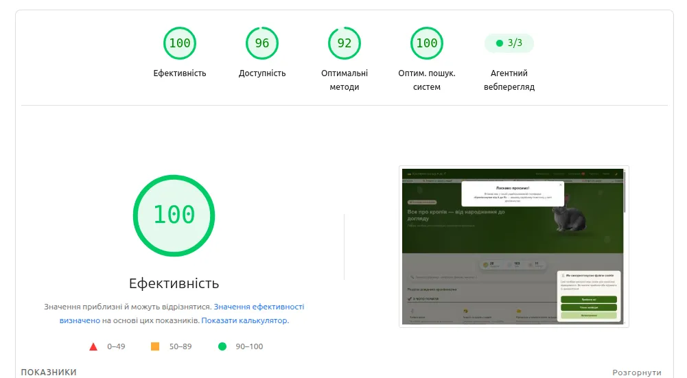
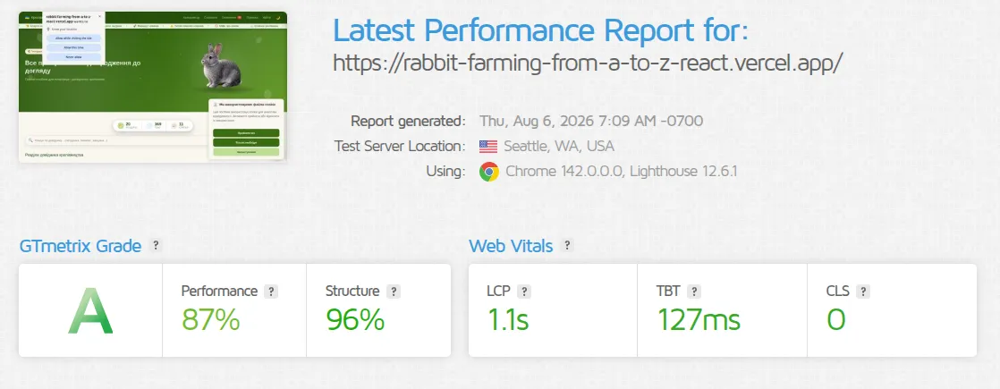
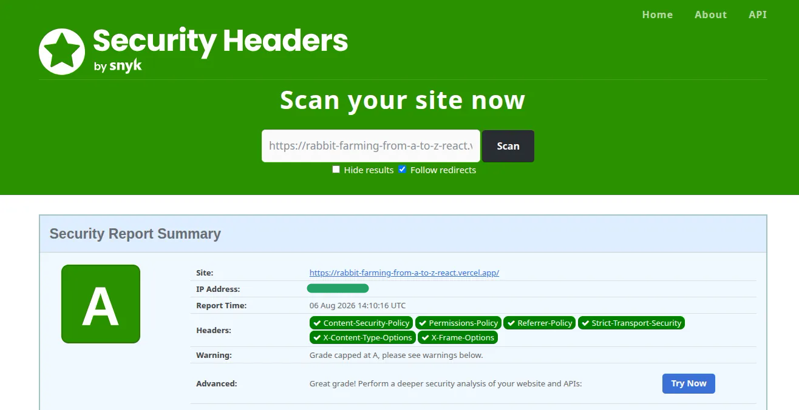

# Звіти якості

> Розділ технічної документації. Короткий огляд проєкту — у [головному README](../../README.md).

## Lighthouse

**Оцінка продуктивності:**

| Метрика        | Значення |
| -------------- | -------: |
| Performance    |      100 |
| Accessibility  |       96 |
| Best Practices |       92 |
| SEO            |      100 |

## GTmetrix

Результати останнього аналізу продуктивності.

  

- Grade: **A**
- Performance: **87%**
- Structure: **96%**
- LCP: **1.1 s**
- TBT: **127 ms**
- CLS: **0**

## Security Report

Перевірка HTTP-заголовків безпеки.

  

- Rating: **A**
- Content-Security-Policy
- Strict-Transport-Security
- X-Frame-Options
- X-Content-Type-Options
- Referrer-Policy
- Permissions-Policy

## Автоматичні перевірки

Проєкт проходить автоматичні перевірки:

- ESLint
- TypeScript
- Unit Tests
- Coverage
- Playwright E2E
- Production Build
- GitHub Actions CI

## Покриття тестами

| Метрика    | Покриття |
| ---------- | -------: |
| Statements |   60.08% |
| Branches   |   44.28% |
| Functions  |   46.66% |
| Lines      |   61.29% |

Звіт за станом на 21.11.2026: 598 unit-тестів у 48 файлах. Усі файли серверної частини (`api/`) покриті майже повністю. Докладніше про запуск і перегляд звіту — у [COVERAGE.md](./COVERAGE.md).

## Безпека

Реалізовано:

- Content Security Policy
- X-Frame-Options
- X-Content-Type-Options
- Referrer Policy
- Permissions Policy
- Cookie Consent
- Захищене підключення до Supabase
- HTTPS
- Digital Asset Links (для TWA)

Правила роботи з секретами й доступом — у [SECURITY.md](../Розробка/SECURITY.md).
